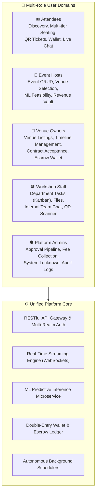
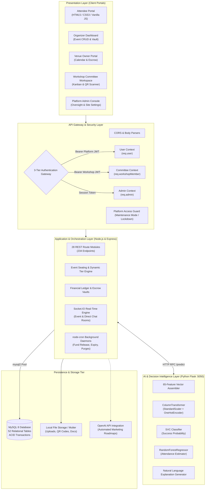
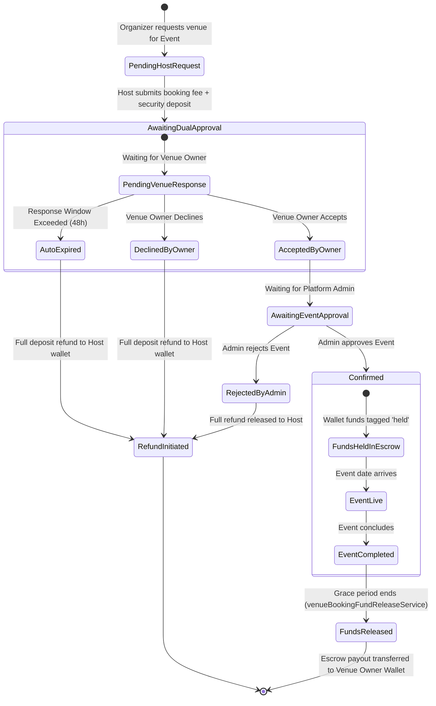
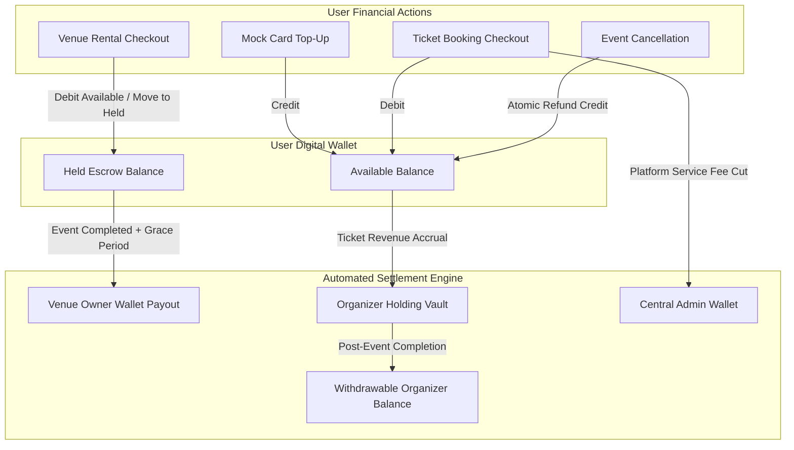
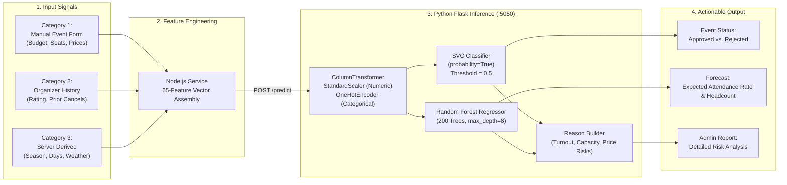
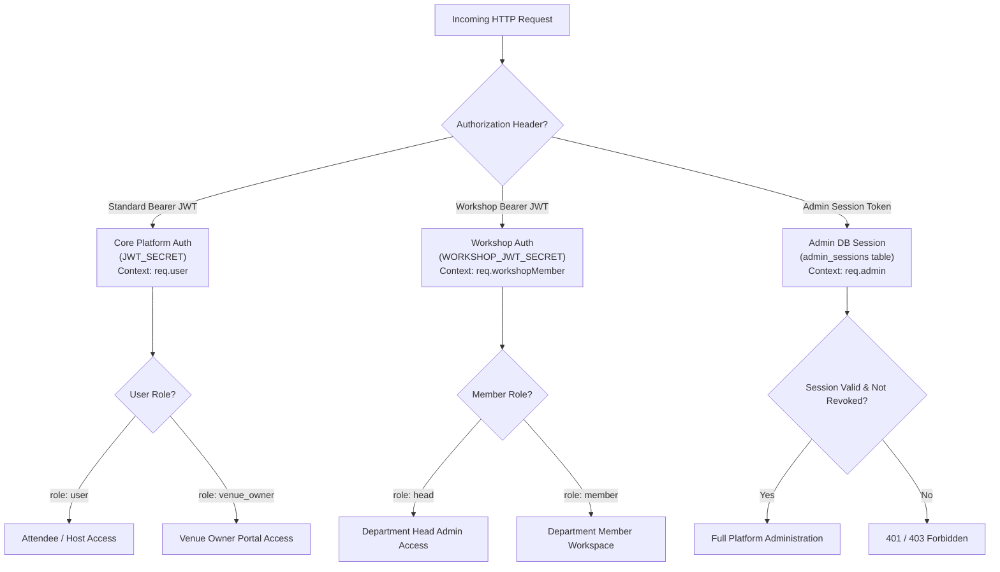

<div align="center">

# 🎪 AI Event Management & Venue Booking Platform

**An enterprise-grade, full-stack event registration and physical venue booking ecosystem powered by dual-model machine learning decision intelligence, financial escrow vaults, real-time WebSockets, and dedicated workshop team workspaces.**

<br />

[](https://nodejs.org/)
[](https://expressjs.com/)
[](https://www.mysql.com/)
[](https://www.python.org/)
[](https://scikit-learn.org/)
[](https://socket.io/)
[](https://swagger.io/)
[](https://jwt.io/)

<br />

[Explore Features](#-key-features) •
[Architecture](#-system-architecture) •
[ML Decision Engine](#-machine-learning--decision-intelligence) •
[Database Schema](#-database-schema--data-architecture) •
[API Docs](#-api-surface--interactive-swagger-docs) •
[Quick Start](#-installation--getting-started)

</div>

---

## 📊 Platform at a Glance

| Core Metrics | Specification | Description |
| :--- | :--- | :--- |
| ⚡ **REST Endpoints** | **234 Endpoints** across **28 Route Modules** | Complete coverage for auth, events, venues, bookings, workshops, and admin. |
| 🗄️ **Database Tables** | **52 Relational MySQL Tables** | Fully indexed, foreign key cascaded, and managed by 22 idempotent migrations. |
| 🤖 **Machine Learning** | **SVC Classifier + 200-Tree Random Forest** | Pre-launch feasibility scoring and expected attendance headcount forecasting. |
| 👥 **Auth Security** | **3 Isolated Authentication Realms** | Platform JWT, Workshop Committee Scoped JWT, and Database Admin Sessions. |
| 💬 **Real-Time Rooms** | **Socket.IO Event & Direct Messaging** | Live attendee chat, host announcement lock, and host ↔ venue owner direct chat. |
| 💰 **Financial Engine** | **Escrow Ledger & Organizer Vaults** | Dual-approval venue escrow, automated ticket refunds, and admin fee collection. |
| 🖥️ **Frontend Views** | **53 Responsive Pages (MVC Architecture)** | 39 user/host/workshop views and 14 dedicated administrative control panels. |

---

## 🎯 Architectural Overview

The **AI Event Management Platform** solves the systemic fragmentation inherent in organizing, financing, staffing, and hosting large-scale events. By uniting event hosts, physical venue owners, workshop committees, attendees, and platform administrators into one coordinated platform, it eliminates manual contracting, financial insecurity, and attendance unpredictability.



---

## ✨ Key Features

### 🏢 Physical Venue Contracting & Smart Escrow
- **Dual Approval Workflow**: An event is only published after both the physical venue owner accepts the reservation and the platform administrator approves the event listing.
- **Conflict Prevention**: Built-in availability timeline calendars block double-booking attempts across specific dates and recurring weekdays.
- **Escrow-Secured Payments**: Venue rental fees and security deposits are automatically tagged as `held` in the financial ledger and released to the venue owner only after the event successfully concludes.

### 🎟️ Dynamic Multi-Tier Ticketing & QR Check-In
- **Granular Seating Plans**: Define chair distribution across **Standard**, **Special**, and **VIP** tiers with tier-specific pricing and seat-number assignments.
- **Automated QR Generation**: Generates cryptographically verifiable QR codes for every ticket upon successful checkout.
- **On-Site Ticket Validation**: Live camera/input scanner for event staff to validate ticket codes in real-time, preventing duplicate check-ins.

### 🧠 Pre-Launch ML Feasibility & Attendance Forecasting
- **Pre-Launch Viability Classifier**: Evaluates whether an event meets approval criteria using an integrated Support Vector Machine (`SVC`).
- **Turnout Prediction Regressor**: Estimates expected attendee turnout and ticket sales volume using a 200-estimator `RandomForestRegressor`.
- **Explainable Insights**: Formulates human-readable decision explanations based on venue capacity ratios, lead-time buffers, organizer history, and market pricing averages.

### 🛠️ Dedicated Workshop Operational Subsystem
- **Department-Level Collaboration**: Purpose-built workspaces for event operational committees (Logistics, Public Relations, Operations, Marketing).
- **Kanban Task Board**: Full task lifecycle tracking (`todo` → `in_progress` → `done`) with member assignments and priority indicators.
- **Internal Messaging & Drive**: Dedicated departmental chatrooms and document file repository secured with extension whitelisting.

### 💳 In-Platform Digital Wallet & Financial Ledger
- **Double-Entry Balance Tracking**: Supports instant card top-ups, ticket purchases, organizer payouts, and card withdrawals.
- **Automated Refund Engine**: Automatically returns ticket funds directly to attendee wallets if an organizer cancels an event.
- **Organizer Holding Vaults**: Holds ticket sales revenue in a protected vault until the event concludes, safeguarding attendee investments.

### 💬 Real-Time Attendee Engagement & WebSocket Channels
- **Live Event Chat**: Real-time room broadcasting powered by Socket.IO with active viewer count tracking.
- **Host Announcement Mode**: Hosts can lock attendee messaging during critical updates or keynote presentations.
- **Direct Messaging**: Dedicated private chat channel between event organizers and physical venue owners.

### 📈 Generative AI Marketing Campaign Roadmaps
- **OpenAI GPT Integration**: Generates structured, step-by-step promotional strategies tailored to target demographics, social channels, and marketing budgets.

---

## 🏛️ System Architecture



---

## 🔄 Core Lifecycles & State Machines

### 1. Venue Booking & Escrow State Machine



---

### 2. Digital Wallet & Financial Ledger Flow



---

## 🤖 Machine Learning & Decision Intelligence

The platform integrates predictive intelligence through a serialized Scikit-Learn pipeline (`event_decision_bundle.pkl`) served by a lightweight Python Flask microservice:



### ML Pipeline Specifications

| Pipeline Element | Component | Configuration | Role |
| :--- | :--- | :--- | :--- |
| **Numeric Preprocessor** | `StandardScaler` | 9 continuous features | Standardizes budget, guest count, lead time, ticket price, and past cancellation counts. |
| **Categorical Preprocessor**| `OneHotEncoder` | `handle_unknown='ignore'` | Encodes event category/type, meteorological season, and day type (weekday/weekend). |
| **Viability Classifier** | `SVC` | `probability=True`, `random_state=42` | Outputs probability score ($0.0 - 1.0$); $\ge 0.5$ results in automated event approval. |
| **Attendance Regressor** | `RandomForestRegressor` | `n_estimators=200`, `max_depth=8` | Predicts attendance percentage; outputs estimated attendee headcount. |
| **Explainability Engine** | Rule-Based Reasoner | 6 heuristic comparison criteria | Compares capacity ratios, price vs. market average, lead times, and marketing scores. |

---

## 🔐 Multi-Tier Authentication & Security



---

## 🗄️ Database Schema & Data Architecture

The MySQL database contains **52 relational tables** divided into 8 operational domains:

```
├── 1. Identity & Profiles
│   ├── users                             # User accounts, credentials, wallet balance, roles
│   ├── followers                         # Follower graph between attendees and organizers
│   └── user_notification_preferences     # Granular email, push, and SMS toggles
│
├── 2. Physical Venues Directory
│   ├── venues                            # Venue specifications, tiers, pricing, location
│   ├── venue_bookings                    # Host-to-venue reservation contracts and escrow status
│   ├── venue_availability_blocks         # Maintenance and date collision blocks
│   ├── venue_wishlist                    # User-bookmarked venues
│   └── venue_reviews                     # Venue ratings and post-event host feedback
│
├── 3. Events & Ticketing
│   ├── events                            # Event metadata, seat capacity tiers, status
│   ├── bookings                          # Ticket purchases, promo code discounts, check-in status
│   ├── booking_ticket_checkins           # Per-seat check-in records with ticket codes
│   ├── event_checkins                    # Consolidated check-in event logs
│   ├── event_views                       # View counting and 24-hour analytics
│   ├── event_reviews                     # Attendee star ratings and reviews
│   ├── event_team                        # Host-assigned team members
│   ├── event_waitlist                    # Waitlist queue for sold-out events
│   └── promo_codes                       # Fixed and percentage promotional discounts
│
├── 4. Financial Ledgers & Escrow Vaults
│   ├── wallet_transactions               # Core ledger (top-ups, debits, refunds, held escrow)
│   ├── wallet_withdrawals                # Bank card withdrawal requests and approval states
│   ├── payments                          # Raw gateway payment transactions
│   ├── event_vaults                      # Organizer holding vaults
│   ├── event_vault_transactions          # Payout releases and holding deductions
│   ├── platform_wallet                   # System fee accumulation wallet
│   ├── platform_wallet_transactions      # Platform commission audit trail
│   └── admin_wallet_transactions         # Administrative fee withdrawals
│
├── 5. Workshop Operations Subsystem
│   ├── workshops                         # Workshop instances mapped to events
│   ├── workshop_categories               # Department committees (Logistics, PR, Operations)
│   ├── workshop_members                  # Staff members with role assignments (head/member)
│   ├── workshop_tasks                    # Kanban task board items, priorities, and deadlines
│   ├── workshop_messages                 # Departmental internal message logs
│   ├── workshop_events                   # Workshop calendar items and meeting schedules
│   ├── workshop_files                    # Attached documents and asset library
│   ├── workshop_activity_log             # Audit trail of committee actions
│   └── workshop_notifications            # Internal team alert dispatch logs
│
├── 6. Communication & Messaging
│   ├── event_chat_messages               # Live attendee event chat streams
│   ├── event_chat_read_state             # Unread message counters per user
│   ├── direct_chats                      # Private host ↔ venue owner chat rooms
│   ├── direct_chat_messages              # Direct messaging chat history
│   ├── direct_chat_read_state            # Direct messaging read tracking
│   ├── notifications                     # Platform-wide user notification alerts
│   └── email_outbox                      # Outbound asynchronous email queue
│
├── 7. AI & Predictive Simulation
│   ├── notebooks                         # Saved ML simulation notebooks with snapshots
│   └── event_marketing_setups            # Saved OpenAI marketing configurations and targets
│
└── 8. System Administration & Oversight
    ├── admins                            # System administrator credentials
    ├── admin_sessions                    # Active admin session tokens with revocation flags
    ├── admin_audit_logs                  # Security and configuration audit trail
    ├── site_settings                     # Platform lockdown, maintenance flags, and fee rates
    ├── faqs                              # System FAQ knowledgebase
    ├── subscription_plans                # Tiered subscription packages
    └── support_tickets                   # User support inquiries and admin responses
```

---

## 🛠️ Tech Stack

<div align="center">

| Domain | Technology | Version | Purpose |
| :--- | :--- | :--- | :--- |
| **Backend Runtime** | **Node.js** | `>= 18.x` | Asynchronous JavaScript runtime environment |
| **Web Framework** | **Express.js** | `^4.18.2` | Core REST API web framework and middleware router |
| **Database** | **MySQL** | `>= 8.0` | Relational SQL database with ACID transaction support |
| **Database Driver** | **mysql2** | `^3.11.0` | Promise-based connection pooling and prepared statements |
| **Real-Time WebSockets**| **Socket.IO** | `^4.8.3` | Bidirectional real-time attendee and direct messaging |
| **ML Framework** | **Scikit-Learn** | `>= 1.3.0` | Serialized SVC classifier and Random Forest regressor |
| **ML Microservice** | **Python / Flask** | `>= 3.9` | Standalone HTTP inference server running on port `5050` |
| **Data Processing** | **Pandas & NumPy** | Latest | Feature payload normalization and array manipulation |
| **Generative AI** | **OpenAI API** | `gpt-4o-mini` | Automated event marketing strategy generation |
| **Authentication** | **jsonwebtoken** | `^9.0.2` | Multi-realm JWT token signing and verification |
| **Password Security**| **bcryptjs** | `^2.4.3` | Salted password hashing |
| **Task Scheduling** | **node-cron** | `^4.2.1` | Automated lifecycle, escrow release, and cleanup jobs |
| **File Handling** | **multer** | `^1.4.5-lts.1` | Multi-part disk storage for photos and team documents |
| **API Documentation** | **Swagger / OpenAPI** | `^5.0.1` | Interactive OpenAPI 3.0 documentation UI at `/api-docs` |
| **Barcode / QR** | **QRCode** | `^1.5.3` | Ticket verification QR code image generation |
| **Frontend Engine** | **Vanilla JS (MVC)** | ES6+ | Lightweight modular Model-View-Controller architecture |

</div>

---

## 📖 API Surface & Interactive Swagger Docs

The backend exposes **234 RESTful endpoints** categorized across 28 modular route controllers:

```
├── /api/Account            -> Registration, login, credential verification, JWT issuance
├── /api/Events             -> Event catalog, dynamic seating maps, reviews, cancellation refunds
├── /api/venues             -> Venue discovery, category filtering, reservation requests
├── /api/venue-owner        -> Venue dashboard, timeline scheduling, proposal approvals, escrow wallet
├── /api/Bookings           -> Multi-seat ticket checkout, QR verification, cancellation previews
├── /api/wallet             -> Balance inspection, mock top-ups, withdrawal requests, transaction ledger
├── /api/workshop           -> Committee management, Kanban tasks, internal chat, live QR scanner
├── /api/notebooks          -> ML simulation sandboxes, feature persistence, live predictions
├── /api/chat               -> Attendee live chat, online count streaming, announcement locks
├── /api/direct-chat        -> 1-on-1 private messaging between host and venue owner
└── /api/Admin              -> Platform analytics, venue/event approvals, fee management, lockdown gates
```

### Interactive Swagger UI
When the backend server is running, explore and test the entire API via Swagger:
- **Interactive UI**: `http://localhost:5000/api-docs`
- **Raw OpenAPI 3.0 Spec**: `http://localhost:5000/api-docs.json`

---

## 📁 Project Directory Structure

```text
AI-Event-Management-Platform/
├── backend/
│   ├── config/                     # Database pool connection & Swagger OpenAPI specs
│   ├── controllers/                # Request validation and business flow controllers
│   │   └── admin/                  # Administrative controllers
│   ├── middleware/                 # Multi-realm JWT guards, access control, and platform gates
│   │   └── admin/                  # Admin session verification middleware
│   ├── models/                     # SQL data access objects & query builders (52 tables)
│   ├── routes/                     # Express REST route declarations (28 files)
│   │   └── admin/                  # Admin API endpoints
│   ├── services/                   # Domain logic: Escrow, ML, Chat, Lifecycle, Vaults
│   ├── utils/                      # Socket handlers, seeders, and pricing calculators
│   ├── migration_*.js              # 22 sequential database migration scripts
│   ├── seed_full.js                # Full database seeding script (500 users, 20 venues)
│   └── server.js                   # Application bootstrap and server entry point
├── database/
│   ├── init.sql                    # Initial database creation and schema definitions
│   └── create-all-tables.sql       # Comprehensive idempotent SQL table creation script
├── docs/                           # System specifications and MVC architectural guidelines
├── event_ai_decision_system/
│   ├── event_decision_bundle.pkl   # Serialized Scikit-Learn ML pipeline bundle
│   └── predict_service.py          # Python Flask inference microservice (Port 5050)
├── frontend/
│   ├── admin/                      # 14 Administrative dashboard management views
│   ├── css/                        # 40 custom responsive stylesheets
│   ├── html/                       # 39 attendee, organizer, and workshop HTML views
│   ├── js/                         # Modular JavaScript MVC controllers, models, and views
│   │   ├── mvc/                    # Structured Model-View-Controller modules
│   │   └── workshop/               # Workshop operational scripts (Kanban, Chat, Scanner)
│   ├── public/                     # Global authentication guards, navbars, and utilities
│   └── uploads/                    # Local asset storage (profile pictures, workshop files)
└── README.md                       # Comprehensive platform documentation
```

---

## 🚀 Installation & Getting Started

### Prerequisites
- **Node.js**: `v18.x` or later
- **MySQL**: `8.0` or later
- **Python**: `3.9+` (with `pip`)

---

### Step 1: Clone the Repository
```bash
git clone https://github.com/Mohamed-Abdelaty/AI-Event-Management-Platform.git
cd AI-Event-Management-Platform
```

---

### Step 2: Install Node Dependencies
```bash
# Install root and backend dependencies
npm install
cd backend
npm install
cd ..
```

---

### Step 3: Configure Environment Variables
Create a `project.env` file in the `backend/` directory by copying the example:
```bash
cd backend
cp project.env.example project.env
```

Configure your environment settings:

```env
# Server Configuration
PORT=5000
CORS_ORIGIN=http://localhost:5000

# MySQL Database
DB_HOST=localhost
DB_USER=root
DB_PASSWORD=your_mysql_password
DB_NAME=event_registration_db

# Multi-Tier JWT Secrets
JWT_SECRET=super_secret_platform_key_change_in_production
JWT_EXPIRE=7d
WORKSHOP_JWT_SECRET=super_secret_workshop_key_change_in_production
ADMIN_JWT_SECRET=super_secret_admin_key_change_in_production

# Python ML Microservice
PREDICT_SERVICE_HOST=127.0.0.1
PREDICT_SERVICE_PORT=5050

# Optional Generative AI Integration
OPENAI_API_KEY=sk-your-openai-api-key
OPENAI_MODEL=gpt-4o-mini
```

---

### Step 4: Database Initialization
Start your MySQL server and create the database:
```sql
CREATE DATABASE event_registration_db;
```

Import the database schema:
```bash
mysql -u root -p event_registration_db < database/create-all-tables.sql
```
*(Note: When `server.js` boots, `databaseSetup.js` and all 22 migration scripts execute automatically, ensuring all tables, columns, and indexes are synchronized).*

---

### Step 5: Start the Python ML Decision Microservice
In a separate terminal window:
```bash
cd event_ai_decision_system
pip install flask joblib pandas scikit-learn
python predict_service.py
```
The decision microservice will start on `http://localhost:5050`.

---

### Step 6: Start the Backend Server
In your main terminal window:
```bash
cd backend
npm run dev
```
*(or `npm start` for production mode)*.

The application server will start on `http://localhost:5000`.

---

### Step 7: Access the Portals

| Portal | URL | Description |
| :--- | :--- | :--- |
| **Public Application** | `http://localhost:5000/html/signin.html` | Attendee discovery, seat reservations, and organizer dashboard |
| **Admin Panel** | `http://localhost:5000/admin/login.html` | Platform moderation, venue approvals, and financial overview |
| **Interactive API Docs**| `http://localhost:5000/api-docs` | Interactive Swagger OpenAPI 3.0 documentation |

---

## ⏰ Background Daemons & Scheduled Jobs

On server launch, `server.js` starts four automated background `node-cron` workers:

1. **Event Lifecycle Engine (`eventLifecycleService.js`)**: Runs hourly to transition past events to `expired` status, compiles final revenue statistics, and notifies organizers.
2. **Venue Booking Expiration Worker (`venueBookingExpiryService.js`)**: Automatically expires pending venue reservation requests if the venue owner does not respond within the 48-hour response window.
3. **Escrow Fund Release Worker (`venueBookingFundReleaseService.js`)**: Safely transitions held escrow balances to venue owner wallets once the post-event grace period concludes.
4. **Chat Retention Purge Worker (`chatCleanupService.js`)**: Runs daily cleanup tasks to archive and prune historical attendee event chat messages.

---

## 🧪 Comprehensive Database Seeding

To populate the database with realistic sample data for local testing, run the seed script:

```bash
cd backend
node seed_full.js
```

### What the Seed Script Generates:
- **500 Registered Users** (`user1` through `user500`, password: `password123`).
- **20 Physical Venue Owners** with approved venue profiles across 20 Egyptian governorates.
- **50 Events** across 20 distinct industry categories (Tech, Music, Business, Art, Sports, etc.).
- Realistic multi-tier seat bookings, promotional discounts, and payment records.
- Wallet transaction ledgers with credits, debits, held escrow funds, and notifications.

---

## 📄 License & Author

This project is licensed under the **ISC License**.

**Author**: Mohamed Abdelaty ([@Mohamed-Abdelaty](https://github.com/Mohamed-Abdelaty))
<br />
Developed as an enterprise-grade full-stack event registration and venue booking management ecosystem.